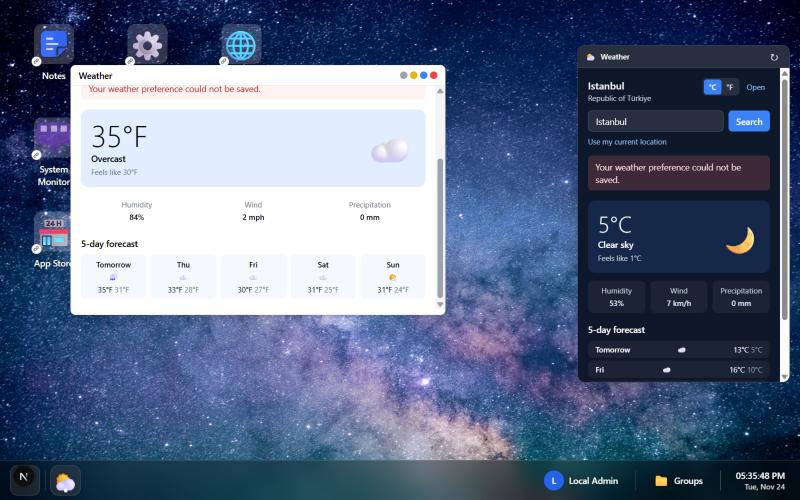

# CodeHubbers

**A small open-source crew building real projects together, learning in public.**

---

### 🪐 What we're working on: OrbitOS

A desktop-style operating system that runs in your browser, with windows, a taskbar, apps, themes, and real-time collaboration. Built with Next.js, React and MongoDB.

  

  <a href="https://orbitos.codehubbers.com"><b>Try it live</b></a> ·
  <a href="https://github.com/codehubbers/OrbitOS">Repo</a> ·
  <a href="https://github.com/codehubbers/OrbitOS/issues">Issues</a>

Lately we added a Weather app with a desktop widget, a Music Player that keeps playing in the background, CI on every pull request, and self-hosting with Docker. Every merge to `main` goes live automatically.

---

### 📦 Projects

| Project | What it is | Stack |
|---|---|---|
| [**OrbitOS**](https://github.com/codehubbers/OrbitOS) | Web OS with a desktop, windows and apps |   |
| [**OrbitOSPackages**](https://github.com/codehubbers/OrbitOSPackages) | Package storage for third-party OrbitOS apps |  |
| [**hubbergram**](https://github.com/codehubbers/hubbergram) | Lightweight, secure messaging server and CLI client in POSIX C |  |
| [**msg-sdk-go**](https://github.com/codehubbers/msg-sdk-go) | Go SDK for the messaging server |  |
| [**msg-sdk-cpp**](https://github.com/codehubbers/msg-sdk-cpp) | C++ SDK for the messaging server |  |
| [**next-step-ai**](https://github.com/codehubbers/next-step-ai) | AI to help students plan their next step |  |

---

### 🤝 Want in?

1. **Say hi on [Discord](https://discord.gg/NW2YZACf4k)**. Tell us what you like to code in.
2. **Pick an issue.** Start with a [good first issue](https://github.com/codehubbers/OrbitOS/issues?q=is%3Aopen+label%3A%22good+first+issue%22) or browse the [board](https://github.com/orgs/codehubbers/projects/2), then comment *"I'd like to take this"*.
3. **Open a PR.** CI checks it, someone reviews it, and once it's merged it's live.

Beginners are welcome. A typo fix or one test is a real contribution, and we'll help you through your first PR.

**Teams.** Once you join the org you're in `core-contributors`, plus a language team: JavaScript/TypeScript, Python, Java, C/C++, Go, Dart or Rust. Ask your team in Discord when you get stuck.

---

Please be kind and read our <a href="https://github.com/codehubbers/.github/blob/main/profile/CODE_OF_CONDUCT.md">Code of Conduct</a>. Questions about the org? Ask on <a href="https://discord.gg/NW2YZACf4k">Discord</a>.
